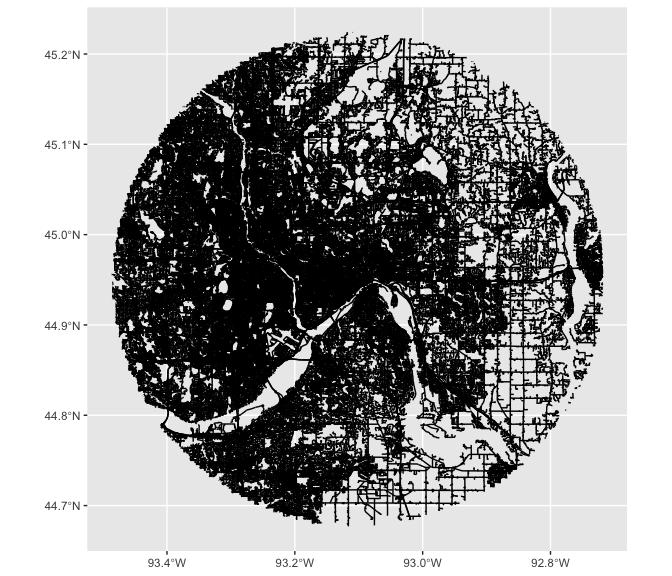
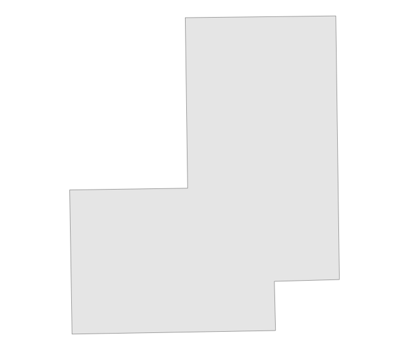
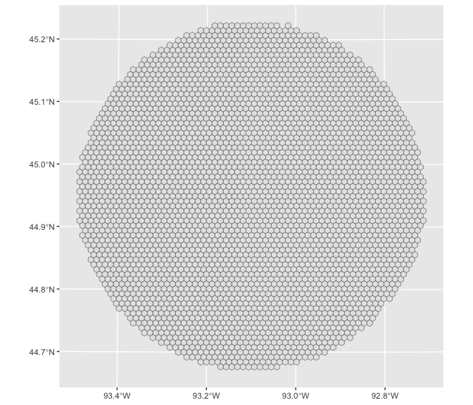
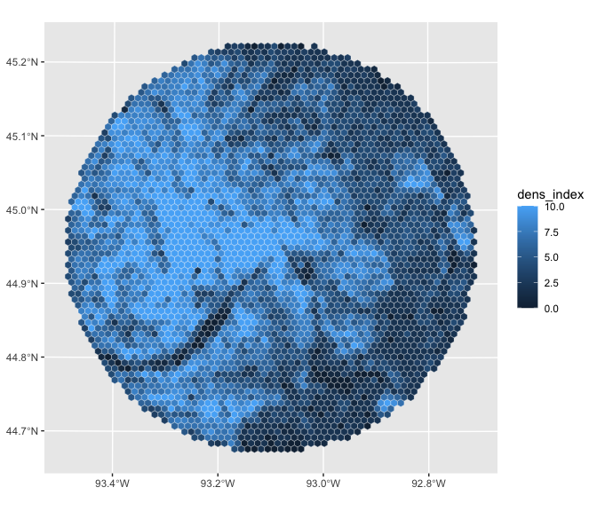
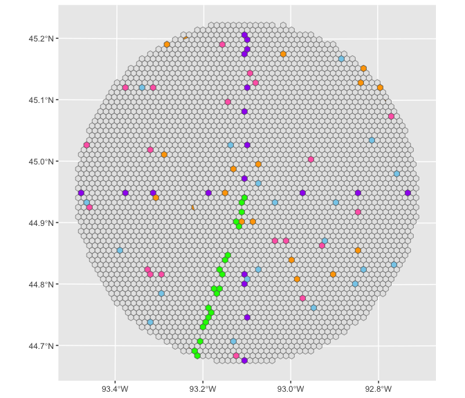

# `uRbano` - functions for spatial sampling across built density gradients

## Introduction

`uRbano` is designed to support urban ecological workflows that combine spatial data acquisition, gridded summaries of urban structure, and
alternative field sampling designs.

The workflow has five main parts:

1.  define the study area,
2.  prepare building and road layers,
3.  create the sampling grid,
4.  calculate grid-level urban metrics, and
5.  generate and visualize sampling schemes.

## Sources

`uRbano` pulls building footprints from various releases of Microsoft's [Open Building Footprints](https://github.com/microsoft/GlobalMLBuildingFootprints/tree/main?tab=readme-ov-file) depending on the region of interest

`uRbano` uses the `osmextract` or `osmdata` package to access the OpenStreetMaps API to import road features for calculating road density metrics


Because some functions rely on external spatial data downloads, you may
prefer to set the download-heavy chunks to `eval = FALSE` for package
checks, or replace them with bundled example objects in a production
vignette.

## Installation

`uRbano` is currently available on GitHub. We recommend installing it
using the `pak` package, which provides fast and reliable dependency
resolution.

``` r
#install.packages("pak")
library("pak")
library("ggplot2")
library("sf")
pak::pkg_install("MSP-LTER/uRbano", ask = FALSE)
```

## 1. Create a city-centered study extent

We start by creating a circular buffer around a city chosen by text
input and the radius covering the study area in meters: Saint Paul, MN
with a 30 km radius:

``` r
rad<-uRbano::get_city_rad("Saint Paul", 30000)
```

    ## Multiple cities found:
    ## 1: Saint Paul, Canada (Pop: 5,384)
    ## 2: Saint Paul, USA (Pop: 272,469)

Select number 2

## 2. Extract OSM network and Microsoft building footprints for the city radius

We extract roads from OpenStreetMap within the study area. The larger
the radius around the city, the more time it may take to download the
road length data.

``` r
rds<-uRbano::extract_osm_rds(rad)
```

``` r
ggplot()+geom_sf(data=rds)
```



Then we get building footprints. Since parts of Wisconsin enter the
radius on the other side of the St. Croix river, we can specify two
regions:

``` r
blds<-uRbano::get_bldgs("Minnesota", "Wisconsin")
## getting building footprints from https://minedbuildings.z5.web.core.windows.net/legacy/usbuildings-v2/Minnesota.geojson.zip
## Reading layer `Minnesota' from data source 
##   `/Users/patt0335/Downloads/Minnesota.geojson' using driver `GeoJSON'
## Simple feature collection with 2914016 features and 2 fields
## Geometry type: POLYGON
## Dimension:     XY
## Bounding box:  xmin: -97.24688 ymin: 43.49498 xmax: -89.49984 ymax: 49.36795
## Geodetic CRS:  WGS 84
## getting building footprints from https://minedbuildings.z5.web.core.windows.net/legacy/usbuildings-v2/Wisconsin.geojson.zip
## Reading layer `Wisconsin' from data source 
##   `/Users/patt0335/Downloads/Wisconsin.geojson' using driver `GeoJSON'
## Simple feature collection with 3173347 features and 2 fields
## Geometry type: POLYGON
## Dimension:     XY
## Bounding box:  xmin: -92.89042 ymin: 42.48796 xmax: -86.82782 ymax: 47.07997
## Geodetic CRS:  WGS 84
## Combined building footprints from Minnesota and Wisconsin
```

buildings from both regions are bound together as a simple features
collection, each feature is a single building polygon

``` r
ggplot()+ geom_sf(data=blds[999,])+theme_void()
```



Crop the buildings to the extent of your city Also clean up invalid
geometries that could halt the calculation of area later on (Spherical
geometry gets turned off and back on to restore previous setting)

``` r
bldgs<- uRbano::fix_n_trim_bldgs(blds,rad)
## Spherical geometry (s2) switched off
## although coordinates are longitude/latitude, st_intersects assumes that they
## are planar
## Spherical geometry (s2) switched on
```

Now we want to get the units of our spatial objects in meters for
calculating area selecting the NAD method will look up the North America
Datum EPSG coordinate reference system based on the location of your
city. In this case it is UTM Zone 15N, 26915

``` r
rad_m<-uRbano::transform_to_meters(rad, "NAD")
## Warning: st_centroid assumes attributes are constant over geometries
rds_m<-sf::st_transform(rds, crs=sf::st_crs(rad_m))
bldgs_m<-sf::st_transform(bldgs, crs=sf::st_crs(rad_m))

rad_m
## Simple feature collection with 1 feature and 4 fields
## Geometry type: POLYGON
## Dimension:     XY
## Bounding box:  xmin: 461641.5 ymin: 4947028 xmax: 522238.5 ymax: 5007887
## Projected CRS: NAD83 / UTM zone 15N
##             name country.etc    pop capital                       geometry
## 32180 Saint Paul         USA 272469       0 POLYGON ((517753.8 4961599,...
```

## 3. Create uniform hex grid across the study radius

we are choosing hexagons of 1km across

``` r
SP_grid<-uRbano::radius_hex_grid(rad_m, 1000)
ggplot()+geom_sf(data=SP_grid)
```



## 4. Calculate road length and building area per hexagon

We summarize two features of urban structure calculate inside each
hexagon of the grid: - total building area per grid cell - total road
length per grid cell this can take a little while depending on the size
of your radius and number of grids…

``` r
SP_grid$bldg_ars <- uRbano::calculate_blds_by_grid(SP_grid, bldgs_m)
SP_grid$rd_len <- uRbano::calculate_rds_by_grid(SP_grid, rds_m)
```

The resulting values can be combined into a “built density” index for
plotting These variables can later be used as predictors, descriptors of
the urban environment, or stratification variables for sampling.

To create a coarse urbanization gradient, we classify building area and
road length per hex into quantiles. For readability, this vignette uses
the name `dens_index`.

``` r
SP_grid$bldg_index <- cut(
  SP_grid$bldg_ars,
  breaks = quantile(
    SP_grid$bldg_ars,
    probs = seq(0, 1, 0.2),
    na.rm = TRUE
  ),
  include.lowest = TRUE,
  labels = FALSE
)

SP_grid$rd_index <- cut(
  SP_grid$rd_len,
  breaks = quantile(
    SP_grid$rd_len,
    probs = seq(0, 1, 0.2),
    na.rm = TRUE
  ),
  include.lowest = TRUE,
  labels = FALSE
)


SP_grid$dens_index<-replace(SP_grid$rd_index, is.na(SP_grid$rd_index), 0) + replace(SP_grid$bldg_index, is.na(SP_grid$bldg_index), 0)

ggplot() +
    geom_sf(
      data = SP_grid,
      aes(fill = dens_index),
      color = "white",
      linewidth = 0.1
    )
```



## 5. Run different sampling methods on the grid

``` r

samples<-uRbano::create_sampling_functions(SP_grid, "dens_index")
samples
## $cardinal_transects
## Simple feature collection with 20 features and 6 fields
## Geometry type: POLYGON
## Dimension:     XY
## Bounding box:  xmin: 461641.5 ymin: 4946450 xmax: 521641.5 ymax: 5006495
## Projected CRS: NAD83 / UTM zone 15N
## First 10 features:
##    pred  bldg_ars     rd_len bldg_index rd_index dens_index
## 1  TRUE  43715.18  8384.2493          3        3          6
## 2  TRUE 133368.72 18217.6723          5        5         10
## 3  TRUE 123305.93 17505.7059          5        5         10
## 4  TRUE  76377.50 13213.2897          4        4          8
## 5  TRUE   2278.39   855.2348          1        1          2
## 6  TRUE 145723.15 23257.7406          5        5         10
## 7  TRUE        NA         NA         NA       NA          0
## 8  TRUE  89752.53 18336.2484          4        5          9
## 9  TRUE  71531.07 10863.8992          4        4          8
## 10 TRUE 149644.94 27483.4846          5        5         10
##                          geometry
## 1  POLYGON ((492141.5 5004474,...
## 2  POLYGON ((485141.5 4976761,...
## 3  POLYGON ((470141.5 4976761,...
## 4  POLYGON ((502141.5 4976761,...
## 5  POLYGON ((491641.5 5005340,...
## 6  POLYGON ((491641.5 4979359,...
## 7  POLYGON ((491641.5 4946450,...
## 8  POLYGON ((521141.5 4976761,...
## 9  POLYGON ((491641.5 4962039,...
## 10 POLYGON ((491641.5 4975895,...
## 
## $concentric_rings
## Simple feature collection with 20 features and 9 fields
## Geometry type: POLYGON
## Dimension:     XY
## Bounding box:  xmin: 475141.5 ymin: 4949156 xmax: 517141.5 ymax: 5005629
## Projected CRS: NAD83 / UTM zone 15N
## First 10 features:
##    pred   bldg_ars    rd_len bldg_index rd_index dens_index ring_id
## 1  TRUE 133343.368 19188.761          5        5         10       1
## 2  TRUE 117635.231 17051.498          5        5         10       1
## 3  TRUE  34670.056  9359.178          3        3          6       1
## 4  TRUE 128791.776 20799.150          5        5         10       1
## 5  TRUE  68352.781 12882.135          3        4          7       1
## 6  TRUE  83363.492 13184.915          4        4          8       2
## 7  TRUE  13678.600  1877.574          2        1          3       2
## 8  TRUE 132346.771 21405.627          5        5         10       2
## 9  TRUE   6679.422  4536.201          1        2          3       2
## 10 TRUE 152365.611 22346.861          5        5         10       2
##    inner_radius outer_radius                       geometry
## 1             0        10000 POLYGON ((492641.5 4971854,...
## 2             0        10000 POLYGON ((489141.5 4981380,...
## 3             0        10000 POLYGON ((490641.5 4971854,...
## 4             0        10000 POLYGON ((487641.5 4977050,...
## 5             0        10000 POLYGON ((493641.5 4982246,...
## 6         10000        20000 POLYGON ((499641.5 4964926,...
## 7         10000        20000 POLYGON ((475141.5 4976184,...
## 8         10000        20000 POLYGON ((476641.5 4983978,...
## 9         10000        20000 POLYGON ((500641.5 4961461,...
## 10        10000        20000 POLYGON ((482141.5 4974452,...
## 
## $density_stratified
## Simple feature collection with 20 features and 6 fields
## Geometry type: POLYGON
## Dimension:     XY
## Bounding box:  xmin: 462641.5 ymin: 4949914 xmax: 519641.5 ymax: 5002165
## Projected CRS: NAD83 / UTM zone 15N
## First 10 features:
##    pred   bldg_ars     rd_len bldg_index rd_index dens_index
## 1  TRUE   4169.091  2275.0836          1        1          2
## 2  TRUE  89673.456  6796.3627          4        3          7
## 3  TRUE   1229.133   408.1142          1        1          2
## 4  TRUE         NA         NA         NA       NA          0
## 5  TRUE  24360.372  7750.8078          2        3          5
## 6  TRUE 107433.257 14054.8039          5        4          9
## 7  TRUE  67059.269  8874.9993          3        3          6
## 8  TRUE         NA         NA         NA       NA          0
## 9  TRUE   6973.010  5737.3892          2        2          4
## 10 TRUE 123754.735 19253.1664          5        5         10
##                          geometry
## 1  POLYGON ((489641.5 4949914,...
## 2  POLYGON ((508141.5 4975029,...
## 3  POLYGON ((513141.5 4962905,...
## 4  POLYGON ((509141.5 5001010,...
## 5  POLYGON ((492141.5 4961173,...
## 6  POLYGON ((473141.5 4995814,...
## 7  POLYGON ((506141.5 4968101,...
## 8  POLYGON ((504141.5 4955977,...
## 9  POLYGON ((476641.5 4958575,...
## 10 POLYGON ((494141.5 4978493,...
## 
## $simple_random
## Simple feature collection with 20 features and 6 fields
## Geometry type: POLYGON
## Dimension:     XY
## Bounding box:  xmin: 462641.5 ymin: 4947316 xmax: 518641.5 ymax: 5004763
## Projected CRS: NAD83 / UTM zone 15N
## First 10 features:
##    pred   bldg_ars     rd_len bldg_index rd_index dens_index
## 1  TRUE  7101.1361  6629.8931          2        3          5
## 2  TRUE  2543.5045  2906.9300          1        1          2
## 3  TRUE 86225.2138 13209.9378          4        4          8
## 4  TRUE   370.0271         NA          1       NA          1
## 5  TRUE 59329.7451  7168.2586          3        3          6
## 6  TRUE  1168.8356   426.5153          1        1          2
## 7  TRUE 19378.0878 13378.8554          2        4          6
## 8  TRUE 98657.2000 10914.6544          4        4          8
## 9  TRUE 99707.6936 14331.9917          5        4          9
## 10 TRUE 92410.3180 12340.8360          4        4          8
##                          geometry
## 1  POLYGON ((518141.5 4990618,...
## 2  POLYGON ((505641.5 4967235,...
## 3  POLYGON ((474141.5 4962905,...
## 4  POLYGON ((490141.5 4947316,...
## 5  POLYGON ((492641.5 4998412,...
## 6  POLYGON ((493641.5 4996680,...
## 7  POLYGON ((503641.5 4982823,...
## 8  POLYGON ((474641.5 4962039,...
## 9  POLYGON ((476641.5 4962039,...
## 10 POLYGON ((475141.5 4995814,...
## 
## $random_transect
## Simple feature collection with 20 features and 6 fields
## Geometry type: POLYGON
## Dimension:     XY
## Bounding box:  xmin: 482141.5 ymin: 4947316 xmax: 492141.5 ymax: 4977050
## Projected CRS: NAD83 / UTM zone 15N
## First 10 features:
##    pred  bldg_ars     rd_len bldg_index rd_index dens_index
## 1  TRUE  87604.68 16520.4509          4        5          9
## 2  TRUE  56214.38  8035.2670          3        3          6
## 3  TRUE  56567.58  8393.6260          3        3          6
## 4  TRUE  58933.66 12675.0749          3        4          7
## 5  TRUE 153956.46 17980.5740          5        5         10
## 6  TRUE 149644.94 27483.4846          5        5         10
## 7  TRUE  86489.67  9745.9455          4        3          7
## 8  TRUE  21751.24   305.4002          2        1          3
## 9  TRUE  70281.52 10096.2814          4        3          7
## 10 TRUE  45485.63  5255.7699          3        2          5
##                          geometry
## 1  POLYGON ((491141.5 4975029,...
## 2  POLYGON ((485641.5 4955111,...
## 3  POLYGON ((490641.5 4970699,...
## 4  POLYGON ((485141.5 4955977,...
## 5  POLYGON ((488141.5 4964637,...
## 6  POLYGON ((491641.5 4975895,...
## 7  POLYGON ((486641.5 4958575,...
## 8  POLYGON ((483141.5 4947316,...
## 9  POLYGON ((485141.5 4954245,...
## 10 POLYGON ((487641.5 4962039,...
```

``` r
ggplot()+
  geom_sf(data=SP_grid)+
  geom_sf(data=samples$simple_random, fill="hotpink")+
  geom_sf(data=samples$cardinal_transects, fill="purple")+
  geom_sf(data = samples$density_stratified, fill="skyblue")+
  geom_sf(data=samples$concentric_rings, fill="orange")+
  geom_sf(data=samples$random_transect, fill="green")
```


